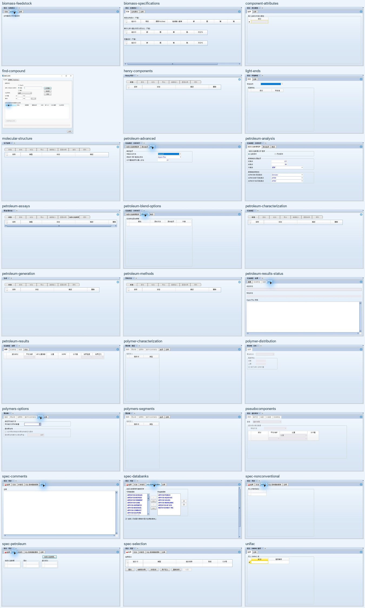

# Aspen Plus UI Shell

**����ǿ��ԭ������ȡ�����ݿ⼰��ѹ���鵵���볤�ڱ����������ڿ������������ؽ�ʱɾ�������ǡ�** `.local/` �е������ʲ����ǻ��棻����·�����鵵�����δ���������� [���ݿ����ñ���ԭ��](docs/database-preservation.md) �� [AGENTS.md](AGENTS.md)��

���� Aspen Plus V15 ���Ľ���� Qt 6 / C++17 ���������ǡ����� **97 ��ԭ��ͼ�ꡢ17 ���Ѻ˶Ե����ҳ�桢39 ��ҳ�ڱ�ǩ**�� 31 �Ųο���ͼ������ **47 ��ģ�顢2,947 �ݾ�̬���֡�289 ����ͳ�Ի���� 106 �ݲ˵���**�Ŀ�����Ŀ¼�� Qt Ԥ��������������ҳǩ�Ϳؼ�Ƭ�Σ�������ͬ������������ҵ��ҳ�档

��ർ�����������Ͳ˵�����תҳ�漰��Դ���ڣ�֧�ֺ���/ǰ������λ���������ݿ��б��ƶ������򵼵������ָ�ҳ������롢��ѡ��ע�ͺͱ�ǩ״̬�����ڱ��λỰ������ 173 ��ԭ��ͼ��285 ��ͼ�����á�ԭ��ֱ�Ӻ�ʵ�������б�����̬״̬��δ��ɱ߽�� [���������¼](docs/ui-interactions.md)����ǰ�汾û�� Aspen �������桢�������ݿ�������ļ����湦�ܣ�������ģ�������˳��󲻱���������롣

��ࡰȫ����Դ����ģ�������������ҳ�桢��ť�Ͳ˵��������á������������顱���ֱ�Ӵ򿪻ָ����֡��Ѻ�ʵ�Ķ�̬ѡ��;�̬����������ɲ�������Ҫ����ı��������δ֪�б����ֲ����á�ÿҳ������Դ��Դ��Ϣ��ɨ�跽���������嵥����һ�ֱ߽�� [������Դ�ָ�����](docs/ui-resource-recovery.md)��

���� V15 �ĸ� APED ����� **6,345,071 ����ֵ��Ԫ**�ѵ������ģ������� 1,464,605 �� API ������ͼ������ active ��ϵ���Լ� TDE��SQLite��Access �������ݡ����ݡ���Դ�嵥�ͺ��鱨��λ�ڱ��� `.local/property-database/plaintext-export/`����δ���뱾Ӧ�á����֡���ƽ̨�ָ�����δ�����ľɸ�ʽ�ļ��� [���ĵ���˵��](docs/plaintext-database-export.md)�����ڵ��鱣���� [�����¼](docs/property-database-investigation.md)��

## ҳ�淶Χ

- �涨��ѡ��ʯ�͡��dz��桢SQL ���������ݿ⡢ע�͡�
- ���ӽṹ��ԭ��/����͡�������ԡ�������֡�������ԡ�Henry ��֡�UNIFAC ���š�
- ʯ�ͱ������б������ɡ�����ѡ���Ʒ�������ݳ���/���ѡ��/�߼�������ѡ�����������ժҪ/״̬����
- �ۺ��������ѡ�ע�ͼ��ֲ���������֣��������ԭ�ϡ�ע�͡�

39 ����ǩ�к��հ����²����õı�ǩ�����ֻ��ԣ�δ�ɼ�������û�в��졣��ϸ���ǡ��������ƺͽ�ͼ��Ӧ��ϵ�� [���ּ�¼](docs/components-research.md)��ԭ��ͼ����Դ�� [ͼ���嵥˵��](docs/ui-assets.md)��



## Mac ���������

������CMake 3.21+��Qt 6.5+ Widgets / Test��C++17 ���������û���ȷ����һ���� Mac ���룻���ִ����� Windows Qt 6.8.3 / MinGW 13.1 ���뼰 CTest ͨ�������� macOS GitHub Actions ���ã����н���� Actions Ϊ׼��

```sh
brew install qt cmake ninja
cmake -S . -B build -G Ninja \
  -DCMAKE_BUILD_TYPE=Debug \
  -DCMAKE_PREFIX_PATH="$(brew --prefix qt)"
cmake --build build
ctest --test-dir build --output-on-failure
open build/AspenPlusUIShell.app
```

ֻ��������ʱ�ɼ� `-DBUILD_TESTING=OFF`��Qt �ٷ���װ���û��� `CMAKE_PREFIX_PATH` ��Ϊ��Ӧ `macos` Ŀ¼������Ĭ��ʹ�� offscreen ƽ̨������ȫ���ָ�����/�Ի���/�˵��Ĵ�����47 ��ģ�鵼������Դ��������������ڣ��Լ�ԭ��ͼ�ꡢ17 ҳ��������ǩ��ע��״̬�������رպ���С���ڡ����� `ASPEN_CAPTURE_DIR` �ɱ������ҳ����Ⱦͼ������Ŀ¼��macOS ���������ǩ������֤��δ���á�

## �ṹ

| �ļ� | ���� |
| --- | --- |
| `src/UiShell.cpp` | �����������������ļ����� |
| `src/ComponentWorkspace.cpp` | ҳ�湹�������л�״̬�Ͳ�ѯ���� |
| `src/RecoveredWorkspace.cpp` | ��̬���֡��Ի���Ͳ˵��İ��� Qt ��Ⱦ |
| `ui/components.json` | 17 ҳ��39 ��ǩ���հ����ؼ����� |
| `ui/recovered/` | 47 ģ�鲼�֡���ť/�˵��嵥����Դ��ȶԱ��� |
| `ui/aspen-plus.json` | ����������ť���˵��嵥 |
| `ui/icons/` | ���� PNG ͼ������ͼ��Դ�嵥 |
| `docs/reference/` | 31 ��ԭ���ͼ��У���嵥 |
| `tests/UiSmokeTest.cpp` | ��������Դ���ɼ�� |
| `tools/scan_aspen_ui.py` / `tools/build_ui_catalog.py` | ԭ��/�й���Դɨ�輰��Я�嵥���� |
| `tests/test_ui_resources.py` | BAML��Unicode ��Դ���Ի��򼰲˵�������� |

ԭ���ͼ��ͼ���Ȩ��ԭȨ���ˣ����ֿⲻΪ��Щͼ�������µ����ɡ�ԭʼ��������ơ����ߡ��������Ｐ���������Ự��ͼ��������汾���ơ�
